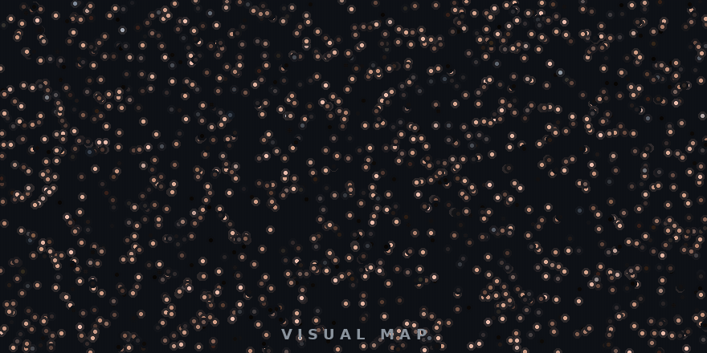

  

  

  
  
  

---

### About Me

BS Information Technology graduate from the **University of Education, Lahore** with hands-on research experience in artificial intelligence and machine learning.

- Research interests: Computer Vision, NLP and Large Language Models, Speech Recognition for low-resource languages (Urdu ASR), Retrieval-Augmented Generation and AI Agents
- Currently working on: Fine-tuning Whisper-small for Urdu speech recognition and YOLOv11 object detection for plant disease diagnosis
- Looking for: MS (Artificial Intelligence) research opportunities - fully funded Master's, Fall 2027
- Ask me about: Python, TensorFlow/Keras, PyTorch, OpenCV, FastAPI, LLMs
- Reach me: muhammadnaveedgurmanii@gmail.com
- Fun fact: My PlantGuard CNN classifies **38 plant diseases** from leaf images at **76.8% test accuracy**

---

### Tech Stack

  
  
  
  
  
  
  
  
  
  
  
  
  
  
  
  
  

---

### GitHub Stats

  
  

  

---

### Featured Projects

| Project | Description | Links |
|---|---|---|
| PlantGuard | CNN-based plant disease detection (final-year project) - 38 classes, 76.8% test accuracy, live web demo | [Demo](https://plantguard.pages.dev) / [Code](https://github.com/muhammadnaveedgurmani/PlantGuard) |
| Urdu ASR | Fine-tuned Whisper-small for Urdu speech-to-text with WER benchmarking (in progress) | [Code](https://github.com/muhammadnaveedgurmani/urdu-asr) |
| AI JobMatch | AI-powered job-matching platform - similarity-based recommendations with REST API backend | [Code](https://github.com/muhammadnaveedgurmani/AI-JobMatch) |
| Safe Child | Child safety platform - behavioral screening module + 7-step abuse report wizard, Urdu/English PWA | [Code](https://github.com/muhammadnaveedgurmani/safe-child) |

---

### Connect With Me

  
  
  
  

---

  <i>Building reliable AI-powered systems - from data pipeline to deployment.</i>

